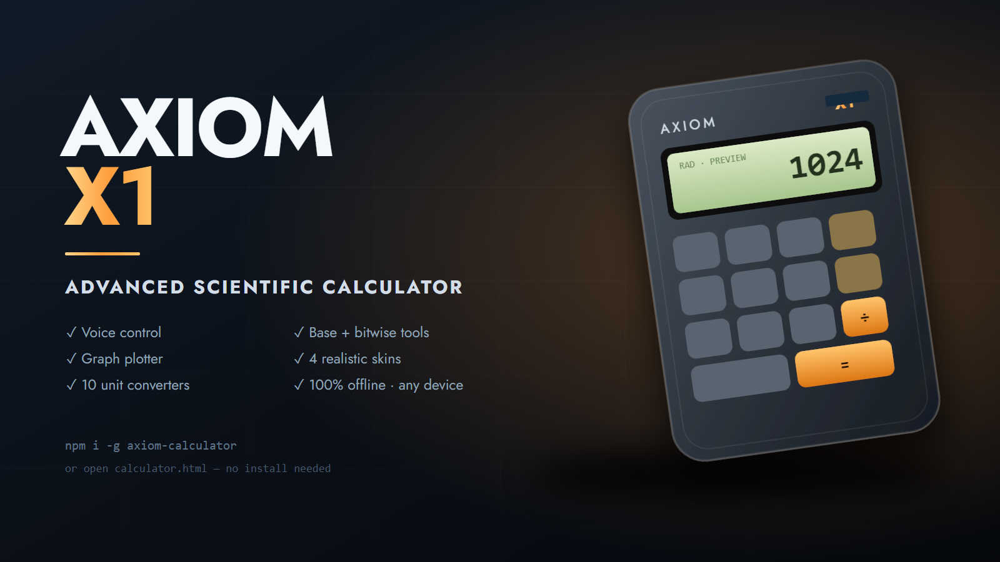
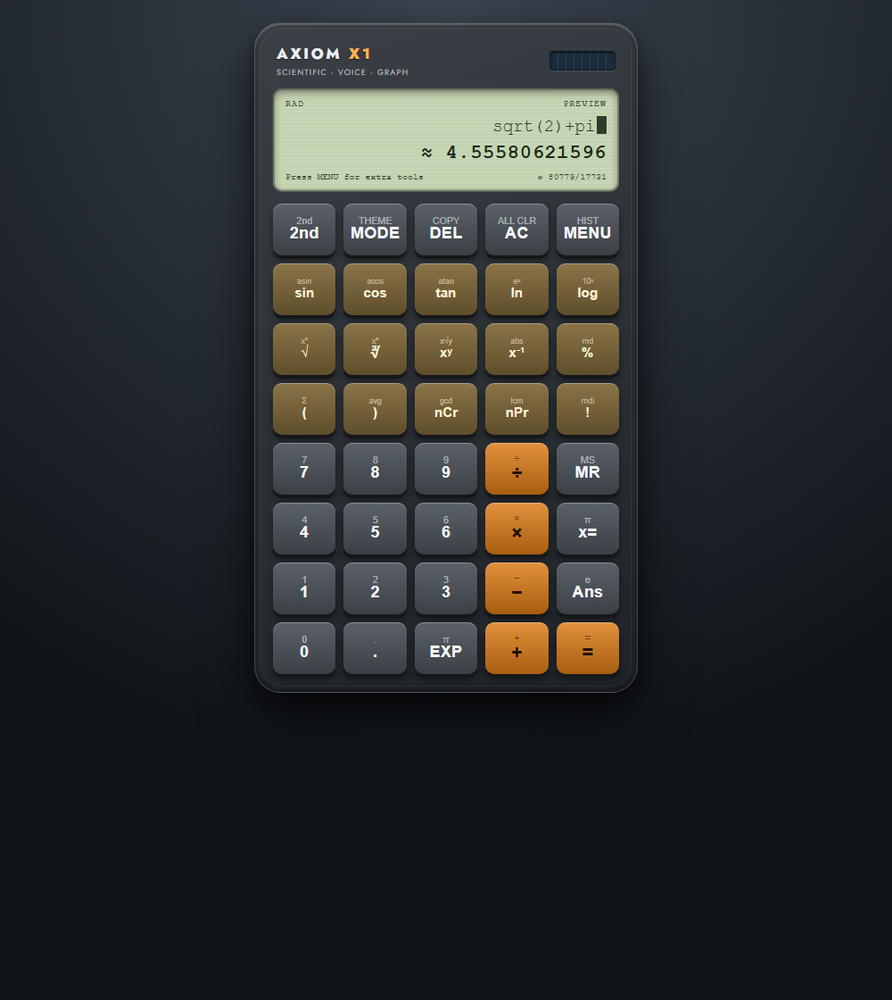
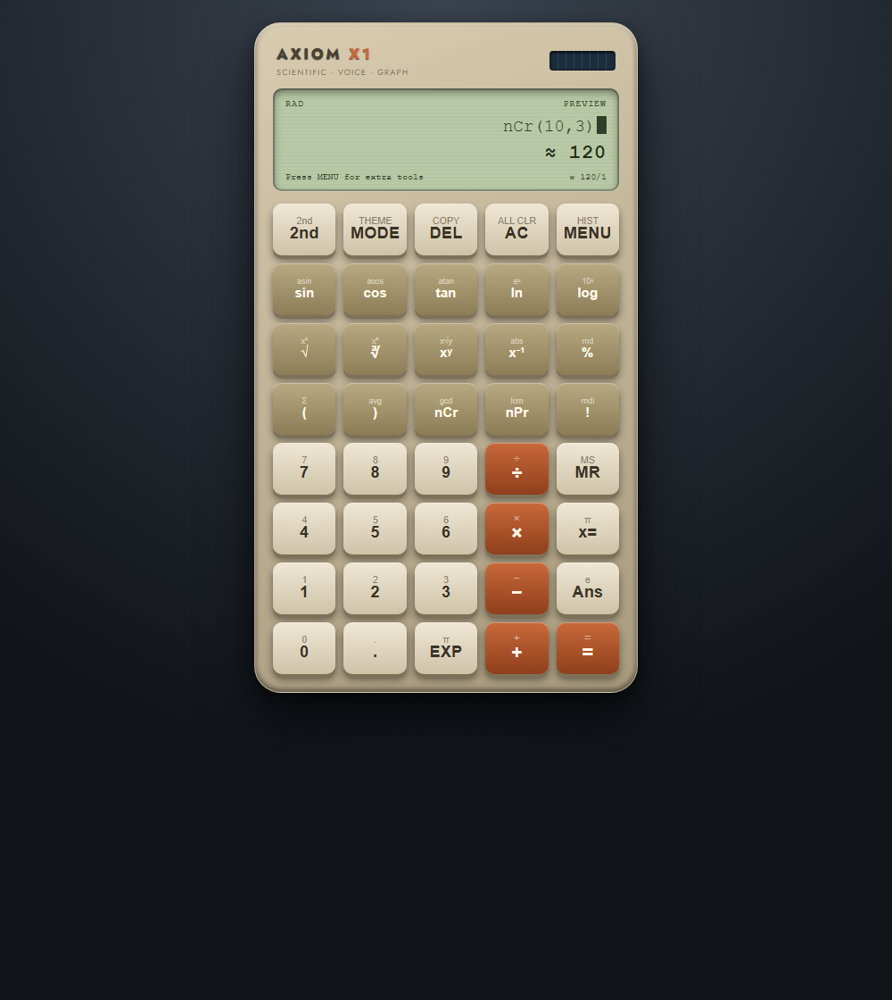
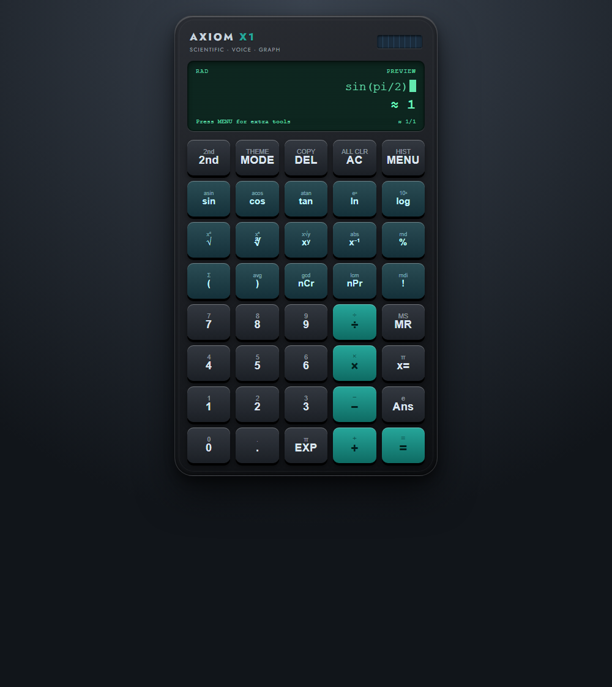
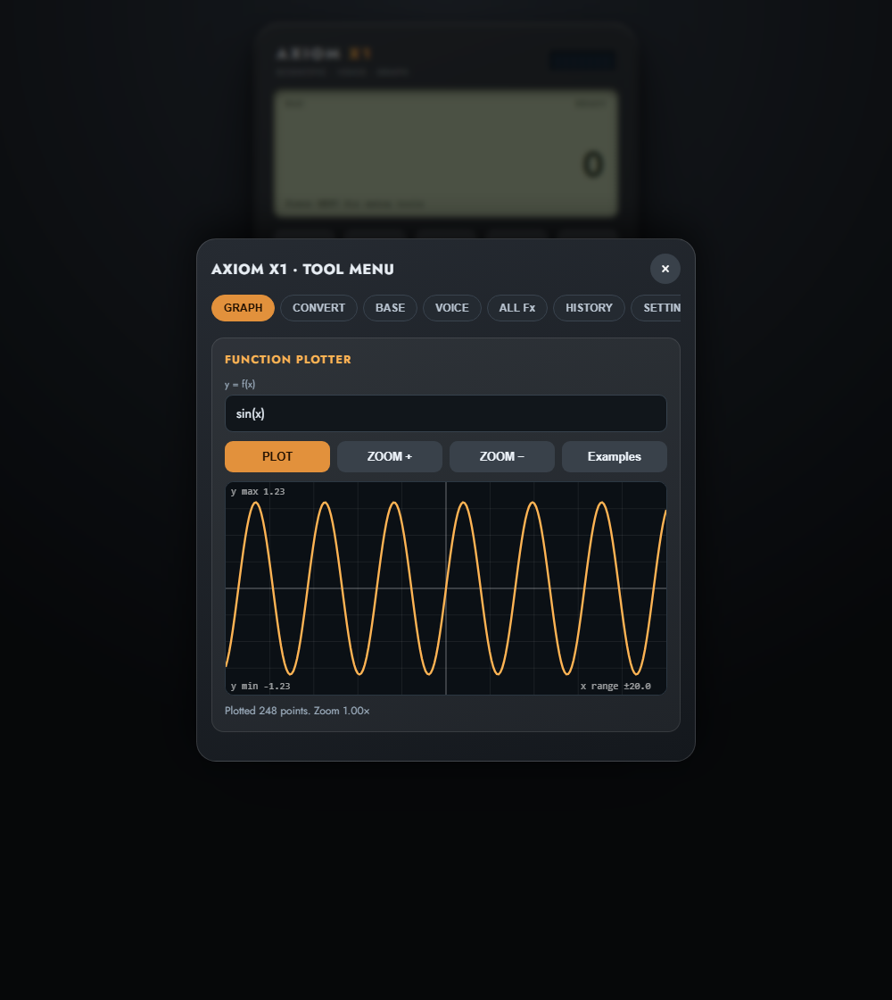
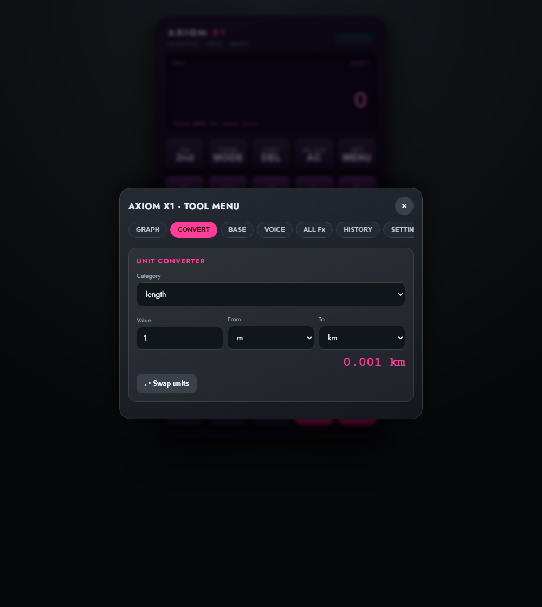
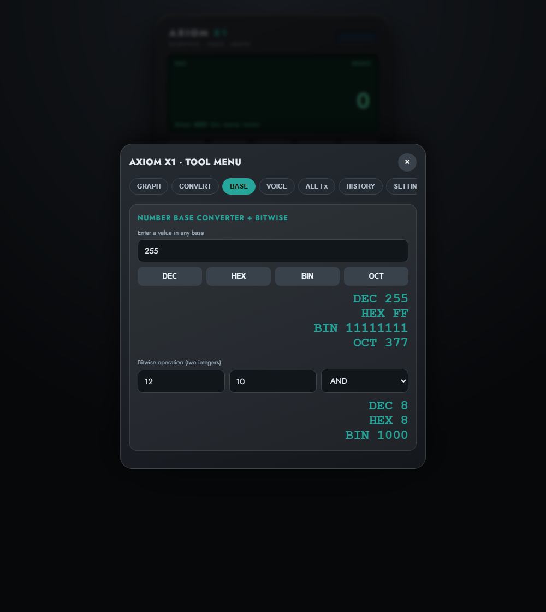
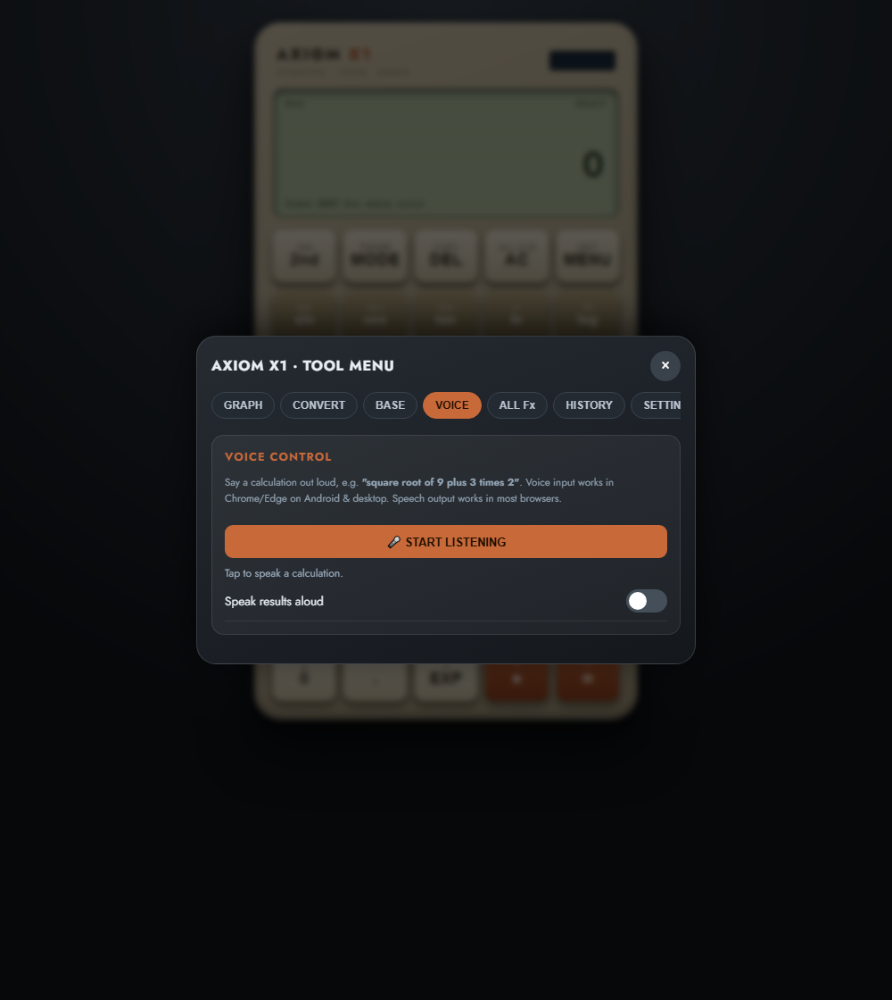
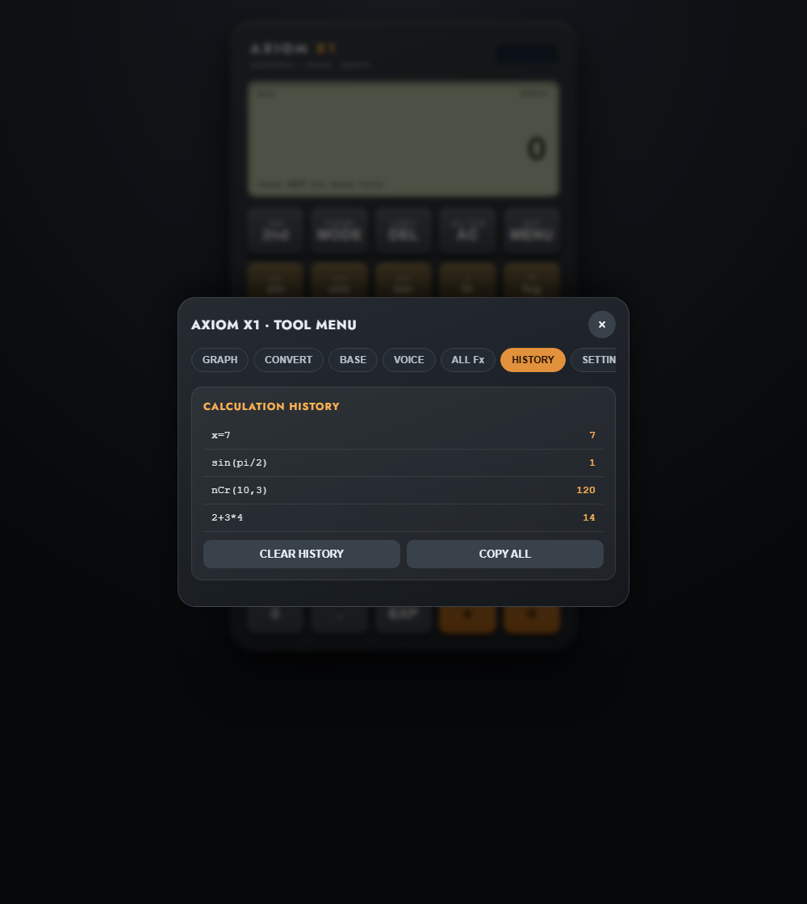
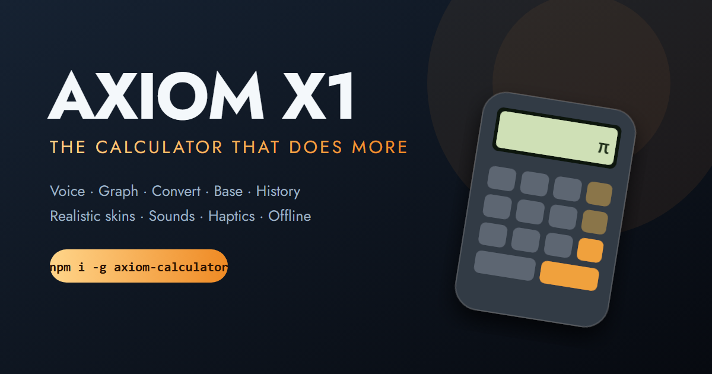

<h1 align="center"></h1>

<p align="center">
  
  
  
  
</p>

<p align="center">
  <b>A realistic, voice-controlled scientific calculator with graphing, unit conversion,
  base conversion, 4 physical skins and genuine offline operation.</b><br>
  One codebase. Any device. Zero setup.
</p>

<p align="center"></p>

---

## ⚡ Quick start (pick one)

| Method | Command / action | Best for |
|---|---|---|
| **Try it instantly** | Open [`app/index.html`](app/index.html) in any browser — no install, no internet | Everyone |
| **Install globally** | `npm i -g axiom-calculator` then run `axiom` | PC / Mac / Linux |
| **No install** | `npx axiom-calculator` | One-off use |
| **Install as an app** | Open the served app and choose **Install app** / **Add to Home Screen** | Android, iPhone, desktop |
| **Build from source** | `cd src && ./build.sh` (or `build.bat` on Windows) | C++ fans |

```bash
$ npm i -g axiom-calculator
$ axiom
  AXIOM X1 — Advanced Scientific Calculator
  Running at: http://localhost:53921/
```

The launcher is a **zero-dependency Node server** that opens the app in your default browser.
Use `axiom --no-open` for a URL only, or `axiom --port=8080` for a fixed port.

---

## ✨ What makes it different

### Hardware that feels real
- Beveled keys that physically depress, with click sounds and phone haptics
- Green LCD with scanlines, inset shadow and a blinking cursor
- Brand plate, model line and solar cell
- A working **2nd / SHIFT** key exposing secondary functions printed above each button

### Features you will not find on a normal calculator
| | Feature | Description |
|---|---|---|
| 🎙️ | **Voice input** | Say *"square root of 9 plus 3 times 2"* — it parses and solves |
| 🔊 | **Speech output** | Reads results aloud |
| 📈 | **Graph plotter** | Plots any `f(x)`, auto-scaled, with zoom |
| 🔄 | **Unit converter** | Length, mass, temperature, area, volume, speed, data, time, energy, pressure |
| 🔢 | **Base converter** | DEC / HEX / BIN / OCT plus AND / OR / XOR / bit shifts |
| 🧮 | **Fractions** | `0.75` → `3/4`, `0.333…` → `1/3` |
| 🎨 | **4 skins** | Classic, Solar, Graphite, Neon |
| ⚡ | **Live preview** | Answer updates as you type |
| 🕒 | **History** | Click any past calculation to reuse it |
| 📋 | **Clipboard** | Copy a result or the whole history |
| ⌨️ | **Keyboard** | Type expressions, `Enter` = `=`, `Backspace` = delete |
| 📴 | **Offline PWA** | Installable; service worker caches the entire app |

### Mathematics
Right-associative powers, unary signs, postfix factorial, parentheses, ~50 functions
(trig / inverse / hyperbolic / logs / roots / combinatorics / statistics / random),
constants `π e τ φ`, variables (`x = 5`), `ans`, `mem`, and DEG/RAD modes.

---

## 📸 Screenshots

| Classic | Solar skin | Graphite skin |
|---|---|---|
|  |  |  |

| Graph plotter | Unit converter | Base + bitwise |
|---|---|---|
|  |  |  |

| Voice control | History |
|---|---|
|  |  |

<p align="center"></p>

---

## 📁 Repository layout

```
axiom-calculator/
├── app/                     # the complete offline web app
│   ├── index.html           # calculator UI + expression engine
│   ├── manifest.webmanifest # PWA install metadata
│   ├── sw.js                # offline service worker
│   ├── icons/               # app icon in every required size
│   └── fonts/               # Jost (OFL) + optional Alro drop-in
├── assets/                  # vector + raster marketing artwork
│   ├── icon.svg  hero.svg  social.svg  wordmark.svg
│   └── *.png                # rendered by scripts/build-assets.ps1
├── docs/screenshots/        # real product screenshots
├── src/                     # portable C++17 console engine
│   ├── main.cpp  build.bat  build.sh
├── bin/cli.js               # zero-dependency npm launcher
├── test/smoke.js            # zero-dependency smoke test
├── scripts/                 # reproducible asset + screenshot generators
├── package.json
├── CHANGELOG.md
├── NOTICE.md                # third-party font notices
└── LICENSE                  # MIT
```

---

## 🔤 Typography

The display face in the reference specimen is **Alro** by **Artyway**
(commercial, Font Bros). Because it cannot legally be redistributed, the repo
ships with **Jost** (SIL OFL 1.1), a geometric twin that keeps the same look
offline for everybody. If you own an Alro web licence, drop
`Alro-Regular.woff2` and `Alro-Bold.woff2` into `app/fonts/` and the app uses
them automatically. See [`app/fonts/README.md`](app/fonts/README.md) and
[`NOTICE.md`](NOTICE.md).

---

## 🧪 Verification

```bash
npm test
```

The smoke test boots the real launcher, requests every critical asset, checks
the PWA manifest and service worker, verifies 404 handling, and exits cleanly.

---

## 📄 License

MIT for all code and artwork in this repository. Third-party font licences are
documented in [NOTICE.md](NOTICE.md). The Alro specimen is © Artyway and is
referenced for identification only; no Alro font binaries are included.

Made with intent — AXIOM X1, 2026.
